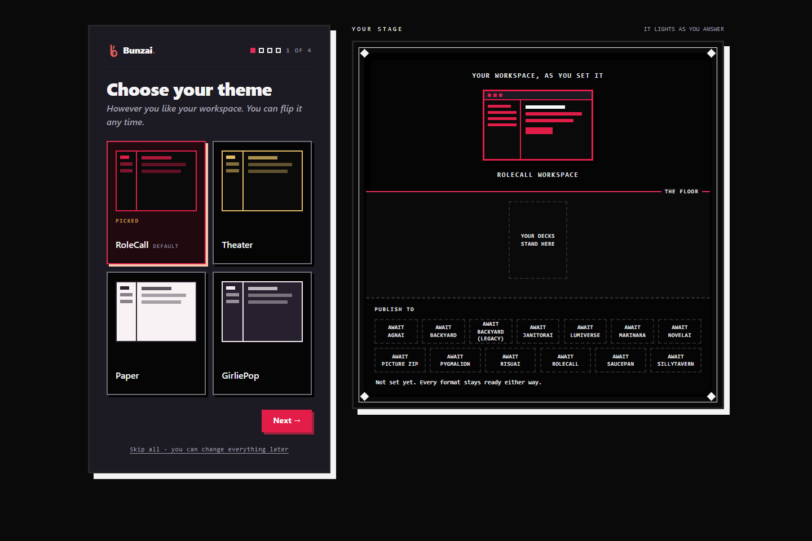
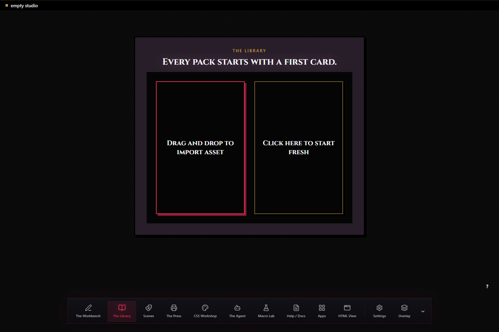
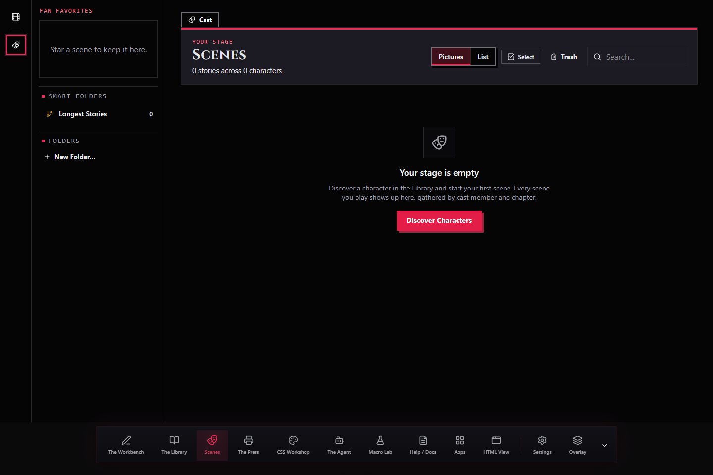

# Install Bunzai

## What is available today

Check the [GitHub Releases page](https://github.com/Vaudeville-Studios/Bunzai/releases) for available packaged files. Published releases provide the Windows desktop app, Windows x64 CLI, Linux x64 and arm64 CLIs, and optional remote-access helper assets. macOS release binaries are held back, so use a source checkout on macOS. If no release is listed, the source checkout below is the supported usable path; do not download an old or guessed asset URL.

Kit is available from a source checkout for development and is not included in release downloads. The browser-only [Studio preview](https://vaudeville-studios.github.io/Bunzai/studio/) is useful for trying import, editing, and export, but its data is held in the tab and disappears when the page is reloaded. Playing scenes requires the installed app.

## Run from source

Use the Bun version pinned by this checkout: **1.4.2**. Bun's [official installation instructions](https://bun.com/docs/installation) cover Windows, macOS, and Linux. After installing, open a new terminal and check `bun --version`.

In the terminal, run:

```sh
git clone --recurse-submodules https://github.com/Vaudeville-Studios/Bunzai.git
cd Bunzai
bun install --frozen-lockfile
bun run dev
```

The recursive clone fetches the pinned RP-Core submodule used by the application. Bun installs the versions recorded in the lockfile. The command starts the Studio server on your computer and prints the address to open; it uses `http://127.0.0.1:8321` by default. If another program owns that port, Bunzai checks the next ten candidate ports and prints the one it bound. Keep the terminal open while you use the Studio; press Ctrl+C there when you are finished.



## First launch

On a new studio folder, the first-run wizard offers choices for appearance, the kinds of pieces you work with, publish targets, and an accent color. You can skip the questions; the choices can be changed later in Settings. After setup, open the Library to import a supported character or create a blank piece.



To play a scene, choose a character and start a scene from the Scenes app. To generate a reply, configure a provider connection in **Settings > Connections**, then choose an available model in **Settings > Models**. Importing, editing, and converting files do not require a provider. A submitted scene turn sends its assembled request to the provider you selected; any provider account or usage charges are separate from Bunzai.



The screenshots above show a disposable local setup. They contain no account credentials or real provider keys.

## Your library and recovery

The installed Studio keeps its encrypted SQLite library in `library.db` inside the studio folder. Unless you choose another folder, that folder is `Documents/Bunzai Studio` in your user profile. The terminal prints the exact path when the server starts. To use another folder, pass it after the port:

```sh
bun run src/cli.ts ui 8321 path/to/my-studio
```

Keep a backup before moving the library or updating a source checkout. In the Studio, use **Settings > Backups** to make a protected backup. A copy of the studio folder includes the encrypted database and its snapshots, but it may also need the password or recovery words and the computer's local key material to open. Keep the recovery words somewhere separate from the computer. Settings > Security explains the password and recovery options for the current library.

The source checkout and your studio folder are separate. Updating or removing the checkout does not delete the studio folder. A newer application can migrate the database when it opens, so make a protected backup before updating. Delete that folder only when you intend to remove the library data; exporting pieces creates a plain, unencrypted folder that should be protected separately.

## Update a source checkout

Stop the running server with Ctrl+C. From the Bunzai checkout, update the source and its pinned submodule, then install the recorded dependencies again:

```sh
git pull --ff-only
git submodule update --init --recursive
bun install --frozen-lockfile
bun run dev
```

The update commands do not delete your studio folder, though a newer program may migrate its database on startup. Make a backup first if the library matters to you. If Git reports local changes or cannot fast-forward, stop and review those changes instead of forcing a reset.

## If something does not open

- **Bun is missing or too old:** run `bun --version`; this checkout pins 1.4.2. Follow Bun's official install or upgrade steps, open a fresh terminal, and check again.
- **RP-Core or another package is missing:** from the checkout, run `git submodule update --init --recursive`, then `bun install --frozen-lockfile`.
- **The address differs from 8321:** Bunzai prints the address it actually bound. Open that address, not a guessed port.
- **The Windows desktop app starts without a window:** Windows desktop builds use WebView2. Microsoft's [distribution guide](https://learn.microsoft.com/en-us/microsoft-edge/webview2/concepts/distribution) explains the runtime requirement; the [WebView2 download page](https://developer.microsoft.com/en-us/microsoft-edge/webview2/) provides Microsoft's installer options.
- **A binary does not match your computer:** packaged binaries are platform- and architecture-specific. Check the exact asset name and published checksum on the same GitHub release. The source workflow's platform list does not make an unpublished download available.

## Related guides

- [Get started](getting-started.md)
- [Troubleshooting](troubleshooting.md)
- [Studio and local API reference](../reference/ui.md)
